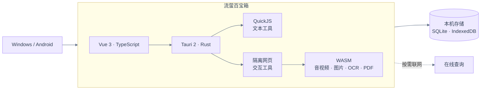

<p align="center">
  
</p>

<h1 align="center">流萤百宝箱 · FireflyToolbox</h1>

<p align="center">
  你的跨端实用工具箱，面向 Windows 与 Android。<br />
  111 项内置工具 · 本地文件处理 · 可自由扩展的 fftool 工具包
</p>


<p align="center">
  <a href="https://v2.tauri.app/"></a>
  <a href="https://www.rust-lang.org/"></a>
  <a href="https://vuejs.org/"></a>
  <a href="https://www.typescriptlang.org/"></a>
  <a href="LICENSE"></a>
  
</p>
<p align="center">
  <a href="#preview">界面预览</a> · <a href="#features">功能一览</a> · <a href="#download">下载与使用</a> · <a href="#extensions">工具扩展</a> · <a href="#architecture">架构</a> · <a href="#development">开发</a> · <a href="#privacy">数据</a> · <a href="#faq">FAQ</a> · <a href="#contributing">贡献</a> · <a href="#license">许可</a> · <a href="#acknowledgments">致谢</a>
</p>

<a id="preview"></a>

## 📸 界面预览

<table>
  <tr>
    <th align="center" width="72%">Windows · 桌面端(已自定义壁纸)</th>
    <th align="center" width="28%">Android · 移动端(已自定义壁纸)</th>
  </tr>
  <tr>
    <td align="center" valign="top">
      <a href="png/pc.png"></a>
    </td>
    <td align="center" valign="top">
      <a href="png/mobile.jpg"></a>
    </td>
  </tr>
</table>


<p align="center"><sub>点击截图查看原图</sub></p>

<a id="features"></a>

## 🧰 功能一览

工具按六个大类组织，支持搜索、收藏、调整顺序与自定义分组。

| 分组       | 常用功能                                                     |
| ---------- | ------------------------------------------------------------ |
| 开发与文本 | JSON、编码解码、文本哈希、正则、Cron、代码格式化与压缩、字数统计、流萤喵语 |
| 图片与影音 | 图片格式转换、压缩、水印、区域像素化、精确取色、图片与 Base64 互转；音视频转换、压缩、剪辑、倍速与 GIF 互转 |
| 文件与文档 | ZIP 压缩解压、Markdown 编辑、图片与 PDF 互转、PDF 合并与页面管理、PDF 加密解密、文档转换 |
| 生活与查询 | 天气、日历、倒数日、油价、金价、汇率、实时票房与常用信息查询 |
| 效率工具   | 屏幕坏点检测、番茄时钟、备忘录、思维导图、短链接、做个决定等 |
| 趣味与AI   | 一句话卡片、电子木鱼、趣味生成、离线文字识别与 AI 资源精选   |

- **本地文件处理**：图片、音视频、OCR、PDF 等引擎随客户端提供，处理过程支持进度、取消与结果保存。
- **屏幕与卡片**：屏幕坏点检测提供 21 种离线全屏图案及自动巡演；一句话卡片提供六套模板、竖排文字、收藏和高清 PNG 导出，公开接口不可用时自动使用内置语料。
- **编辑与绘图**：画板支持矢量绘图与横竖版切换；思维导图支持模板、节点编辑与多格式导出；文本对比支持词级高亮、对比选项，以及并排 / 单栏差异块双向合并、撤销和完整内容另存；Markdown 支持编辑、分栏预览、正文与 H1～H6 标题菜单、自定义表格行列数、文件与 HTML 导出。四项均离线运行，画板、思维导图与 Markdown 默认全屏。
- **扩展工具**：导入或制作 `.fftool` 工具包，也可编辑内置工具源码、导出或恢复默认。
- **日常使用**：网站书签、智能内容识别、文本自动化、配置备份、局域网设备同步与桌面快捷方式。
- **网站浏览**：Android 支持文件上传、普通 HTTP/HTTPS 直链下载、网页 Blob 文件另存、分享、复制网址、外部浏览器打开和页内查找；PC 网站窗口支持网页文件拖放。Blob 文件通过系统窗口选择保存位置，保存期间保持网页打开。
- **个性外观**：浅色、深色与跟随系统，自定义主题色、壁纸、启动图和侧边栏图。
- **桌面集成**：Windows 支持系统托盘、关闭行为设置与开机自启。

<a id="download"></a>

## 📥 下载与使用

前往[官方网站](https://firefly.202132.xyz)或 [GitHub Releases](https://github.com/Iskongkongyo/FireflyToolBox/releases) 获取客户端与版本说明；若尚无可用发行版，可按下方步骤从源码构建。

| 平台 | 使用方式 |
| --- | --- |
| Windows | 运行便携程序，系统需安装 Microsoft Edge WebView2 Runtime，无需另开前端开发服务器 |
| Android | 安装适合设备架构的 APK；当前构建命令生成 `arm64-v8a` 包，最低 Android 7.0（API 24） |

从首页打开和收藏工具，在网站页添加书签；“应用主题”和“更多设置”提供外观及使用偏好。手机和平板通过底栏、抽屉导航，PC 使用侧边栏。

- **备份与同步**：在“更多设置”中管理配置备份；通过“其他 → 设备同步”与同一可互访局域网中的设备配对，选择需要传输的内容。
- **智能识别与快捷方式**：可手动粘贴识别内容，也可在设置中开启剪贴板识别；侧栏支持创建桌面快捷方式，Android 未出现图标时可检查应用授权。
- **网页工具全屏**：可在工具菜单手动切换，或在网页工具设置中开启默认全屏。PC 按 Esc，移动端使用系统返回或从右边缘向左滑退出；PC 在右上方顶边停留、移动端长按右上角空白处可呼出退出按钮。
- **重置设置**：“更多设置 → 其他 → 重置设置”需再次确认，恢复设置时保留工具数据、缓存、最近使用、收藏与网站等内容。

“关于应用”提供检查更新、项目源码和官方网站入口。更新与公告的部署配置见[接入指南](examples/remote-messages/README.md)。

<a id="extensions"></a>

## 🧩 自定义工具

从“工具管理”右上角进入“工具工作台”，创建、导入、编辑和导出 `.fftool` 工具包，也可修改内置工具源码或恢复默认。导入支持多选文件，Windows 还可拖入文件，并支持批量安装。

| 类型 | 适用场景 |
| --- | --- |
| 文本处理 | 使用 JavaScript 在 QuickJS 中执行文本转换，可参与文本自动化 |
| 网页工具 | 使用 HTML、CSS、JavaScript 编写交互页面，支持文件、联网查询及 Worker / WebAssembly 等独立资源 |

将[工具编写指南 SKILL.md](skills/firefly-module-author/SKILL.md)交给 AI，可按应用接口制作工具；模板、接口限制及打包规范均在指南中，可参考[示例工具](examples/modules)。应用内可通过“创建工具 → 查看SKILL”阅读或复制全文。

侧栏“工具市场”连接公开的 [FFTools 工具库](https://github.com/Iskongkongyo/FFTools)，支持搜索、分类、下载和安装，可选择自动加速或官方直连。第三方加速线路接收公开仓库请求；下载校验不代表安全审核，安装前仍需核对作者、源码和权限，联网及覆盖安装需确认。

“工具管理”顶栏还可创建自动化工具，组合最多 8 个文本处理步骤。需要独立打包时，Windows 客户端提供 `--pack-fftool` / `--check-fftool`；使用 npm 依赖的工具可运行 `npm run module:bundle -- <工具目录>` 预编译。

<a id="architecture"></a>

## 🏗️ 架构总览



<a id="development"></a>

## 🛠️ 本地开发

以下命令在仓库根目录执行。

| 环境    | 要求                                                         |
| ------- | ------------------------------------------------------------ |
| 通用    | Git、Node.js 22、npm、Rust 稳定版                            |
| Windows | MSVC 工具链、Visual Studio C++ 构建工具、WebView2 Runtime    |
| Android | JDK 21、Android SDK（API 36）、NDK `26.1.10909125`、Rust target `aarch64-linux-android` |

原生环境安装可参考 [Tauri 开发前置条件](https://v2.tauri.app/start/prerequisites/)。

### 获取源码与启动

```powershell
git clone https://github.com/Iskongkongyo/FireflyToolbox.git
cd FireflyToolbox
npm ci
npm run build:builtin-tools
npm run tauri dev
```

仅预览界面可运行 `npm run dev`；文件、系统窗口等原生能力需要在 Tauri 客户端中使用。

### Windows 构建

```powershell
npm run build:portable
```

### Android 构建

Android 工程已初始化，应用包名为 `firefly.toolbox`。将 `JAVA_HOME` 指向 JDK 21，并根据实际安装位置调整 SDK 路径：

```powershell
$env:ANDROID_HOME = Join-Path $env:LOCALAPPDATA 'Android/Sdk'
$env:ANDROID_SDK_ROOT = $env:ANDROID_HOME
$env:NDK_HOME = Join-Path $env:ANDROID_HOME 'ndk/26.1.10909125'
$env:PATH = (Join-Path $env:JAVA_HOME 'bin') + ';' + $env:PATH
rustup target add aarch64-linux-android
npm run tauri -- android build -d -t aarch64 --apk --ci
```

上面的命令生成 arm64 调试包；正式发布时请配置自己的 release 签名，并保存好签名密钥。

### 常用检查

按改动范围选择检查；提交客户端改动时，请说明 Windows 与 Android 的构建和验证结果。

```powershell
npm run build
cargo test -p toolbox-core -p toolbox-storage
npm run test:module-v7
npm run test:tool-repository:browser
npm run test:web-tool-services:browser
```

完整专项脚本见 [package.json](package.json) 的 `scripts`；原生回归、设备连接和测试目录配置见[开发与验证文档](docs/development/README.md#常用检查)。

Windows 正式便携版可通过 `scripts/test-windows-release-startup.ps1` 检查实际产物启动。涉及数据写入的原生回归应使用临时工具或隔离配置，并恢复相关数据与设置；涉及测试地址的构建，交付前须恢复正常配置并重新编译。

<a id="privacy"></a>

## 🔐 数据与联网

- 收藏、书签、工具定义和偏好保存在当前设备；配置管理提供部分数据的导入导出，工具包和设备同步用于迁移工具。自 0.1.69 起，设备同步可单独勾选网页工具的持久数据（两端需 0.1.69 或更新版本）；默认保留本机同名键，勾选覆盖时按工具替换整份数据。预览与会话数据不参与同步。
- 图片、音视频、OCR、PDF 等离线工具在本机处理文件；天气、票房、价格及其他在线查询需要网络，第三方网站入口使用对应网站的服务。
- 配置消息源后，应用启动会请求更新与通知 JSON；失败保持静默，不上传工具、账号或已读记录。远程正文经过 HTML 清理，图片与链接仅允许 HTTPS；点击链接与下载按钮时使用系统浏览器，不自动安装。已读记录仅保存在本机，不参与配置备份或设备同步。
- 自定义联网工具须声明 HTTPS 来源；实际发送的数据取决于工具源码及操作。第三方接口的可用性、额度和规则由服务提供方决定。
- 打开“工具市场”会按所选线路请求 FFTools 公开文件列表及提交记录；点击下载后才获取工具包，不后台安装。第三方加速线路及官方直连可在页面切换。
- 智能剪贴板识别与最近使用记录可在“更多设置”中切换；提交问题或示例文件时，请移除个人信息。

<a id="faq"></a>

## ❓ 常见问题

| 问题                         | 说明                                                         |
| ---------------------------- | ------------------------------------------------------------ |
| 可以完全离线使用吗？         | 本地处理工具及其引擎可离线使用；在线查询和外部网站需要网络   |
| 为什么较小的图片也可能超限？ | 文件字节数、像素数、画布尺寸和可用内存是不同限制；以各工具内的提示为准 |
| 工具为什么会显示接口不可用？ | 公开接口可能临时失效或调整；请附上工具名称、版本和错误信息反馈 |
| Android 提示无法覆盖安装？   | 自行构建与已安装版本的签名可能不同；迁移或重新安装前先备份所需配置 |
| 能自己添加功能吗？           | 可以制作 `.fftool` 文本或网页工具，也可直接编辑内置工具源码  |

<a id="contributing"></a>

## 🤝 参与贡献

欢迎通过 [Issues](https://github.com/Iskongkongyo/FireflyToolbox/issues) 反馈问题、提出功能建议，或提交 [Pull Request](https://github.com/Iskongkongyo/FireflyToolbox/pulls)。

反馈问题时，请提供应用版本、系统与设备信息、复现步骤、预期结果和实际报错；文件处理问题可附上脱敏后的最小样例。提交代码时，请描述解决的问题、改动范围及已完成的检查；引入新的引擎、模型、字体或素材时，请同时补充来源与授权说明。

<a id="license"></a>

## 📄 许可证

本项目自身代码使用 [MIT License](LICENSE)。第三方引擎、依赖、模型和素材遵循各自的许可，项目的 MIT 许可不替代这些组件的授权。

- FFmpeg 核心为 **GPL-2.0-or-later**，保留 [许可文本](src-tauri/builtin-tools/data/ffmpeg-gpl-2.0.txt)；来源与构建适配记录在 [引擎构建脚本](scripts/build-media-core.mjs)。
- ImageMagick、ONNX Runtime、PDF 引擎与字体等的许可、来源及 NOTICE 随各自资源提供；构建时一并封装到工具资源中。
- OCR 模型与字符字典取自 [OOCCRR 图片文字识别工具](https://www.ooccrr.com/zh/image-ocr/)；具体下载地址、文件大小和 SHA-256 见 [模型记录](src-tauri/builtin-tools/data/ocr-models/models.json)，来源、适配及模型许可信息见 [模型说明](src-tauri/builtin-tools/data/ocr-models/MODEL-NOTICE.md)。

<a id="acknowledgments"></a>

## 💖 致谢

感谢以下开源项目及其维护者：

- [Tauri](https://github.com/tauri-apps/tauri)、[Rust](https://github.com/rust-lang/rust)、[Vue](https://github.com/vuejs/core)、[Vite](https://github.com/vitejs/vite)、[Pinia](https://github.com/vuejs/pinia) 与 [SQLite](https://sqlite.org/)。
- [QuickJS](https://bellard.org/quickjs/)、[FFmpeg.wasm](https://github.com/ffmpegwasm/ffmpeg.wasm)、[magick-wasm](https://github.com/dlemstra/magick-wasm)、[ONNX Runtime](https://github.com/microsoft/onnxruntime)、[PDF.js](https://github.com/mozilla/pdf.js)、[pdf-lib](https://github.com/Hopding/pdf-lib) 与 [qpdf](https://github.com/qpdf/qpdf)。
- [Shields.io](https://shields.io/) 提供项目徽章，[GitHub Mermaid](https://docs.github.com/en/get-started/writing-on-github/working-with-advanced-formatting/creating-diagrams) 提供架构图渲染。

也感谢提供问题反馈、功能建议和改进代码的使用者与贡献者。
